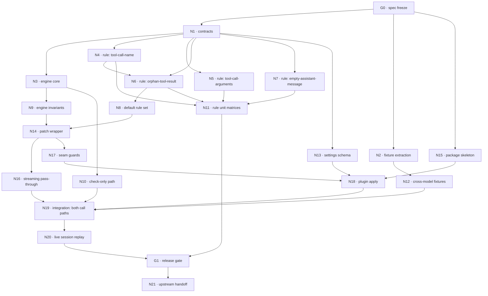

# dsh-healer — implementation workflow (node graph)

Companion to [`DECISIONS.md`](DECISIONS.md) (evidence and rationale) and
[`SPEC.md`](SPEC.md) (original problem statement). This file is the execution
plan: a dependency graph of nodes, each with an owner scope, a write scope, and
a machine-checkable exit gate.

**Rule of the graph:** a node may not start until every node it depends on has
passed its exit gate. Nodes on the same level are independent and may run in
parallel — but only when their write scopes are disjoint.

---

## 1. Graph



### Level map

| Level | Nodes                      | Runs in parallel?        |
| ----- | -------------------------- | ------------------------ |
| 0     | G0                         | —                        |
| 1     | N1, N2, N15                | yes (disjoint)           |
| 2     | N3, N4, N5, N6, N7, N13    | yes                      |
| 3     | N8, N9, N10, N11, N12, N14 | partly — N14 waits on N8 |
| 4     | N16, N17, N18              | yes                      |
| 5     | N19                        | —                        |
| 6     | N20                        | —                        |
| 7     | G1                         | —                        |
| 8     | N21                        | —                        |

**Critical path:** `G0 → N1 → N4 → N6 → N8 → N14 → N16 → N19 → N20 → G1`.

---

## 2. Nodes

Each node lists: **depends**, **write scope**, **work**, **exit gate**.

### G0 · Spec freeze — gate

**Depends:** — · **Write scope:** `SPEC.md`, `DECISIONS.md`

Apply the twelve corrections in DECISIONS.md §B to `SPEC.md`. The spec currently
contains a code sample that breaks every LLM call (correction 1) and a test
assertion that cannot hold in a real profile (correction 3); neither may be
carried into implementation.

**Exit gate:** every row of DECISIONS.md §B is either applied to `SPEC.md` or
explicitly rejected in writing with a reason. No implementation node starts
before this passes.

---

### N1 · Contracts — types only

**Depends:** G0 · **Write scope:** `src/types.ts`

Define `Finding`, `DetectContext`, `RepairContext`, `Rule`, `RepairDecision`,
`HealReport`, `SkippedRule`, `AppliedFix` exactly as in DECISIONS.md D-8/D-9.
No runtime code, no imports beyond `import type`.

**Exit gate:** `tsc --noEmit` clean; no value exports; the file compiles under
`--experimental-strip-types` (types erase to nothing).

---

### N2 · Fixture extraction

**Depends:** G0 · **Write scope:** `test/fixtures/**`

Extract the real incident material into committed fixtures, **redacted of any
local absolute path**:

1. `poisoned-assistant.json` — the `assistant/message` at seq 4810 containing
   `{"type":"tool-call","id":"call-3","name":"","arguments":""}` at content index
   3, with the `reasoning`/`text` blocks that precede it.
2. `orphan-result.json` — the `role:"tool"` message at seq 4812
   (`toolCallId: "call-3"`, `Error: unknown tool ""`, `isError: true`).
3. `history-around.json` — enough neighbouring messages to build a realistic
   multi-message list, including at least one valid `tool-call` **with** a
   matching result, so the orphan rule has a positive control.
4. `stream-4810.json` — the durable `stream` record showing
   `block-start {index:3, blockType:'tool-call'}` with no `tool-call-delta` and no
   `block-end`, which is the evidence for the corrected root cause.
5. `poisoned-assistant-second.json` — the second independent occurrence
   (session `zesto`, log line 7363, seq 7361, id `call-1`), where a **valid**
   tool call sits beside the fabricated one in the same message. This is the
   fixture that forbids "drop the whole assistant message" as a repair.

DSH names a session directory after the project's absolute path, with the
separators replaced by dashes; `<project>` stands in for that here, so no
machine path is written down. The session id identifies the log.

Source: `~/.dsh/sessions/<project>/session-a6471351-808c-4722-8307-5db9535ea701/session.v4.jsonl.zstd`
and `~/.dsh/sessions/<project>/session-1478ceb4-646c-4bde-89bd-af9d2b918409/session.v3.jsonl.zstd`
(note: that file name is misleading — its payload is the v4 event format).
These are local session logs — extract only the message payloads, never paths,
never credentials.

**Method requirement (learned the hard way).** Find occurrences by parsing every
session file with `JSON.parse` and inspecting the message objects. Do **not**
conclude absence from a literal grep, and do not trust a session filename to
predict its payload format: the second occurrence lives in a file named `.v3`
that contains v4 events, with spaces after JSON colons.

**Exit gate:** a loader test reads all five fixtures and asserts the poisoned
block is present with `name === ''` and `arguments === ''` in both occurrences,
and that the second fixture contains a _surviving_ valid call beside it;
`grep` over `test/fixtures/**` finds no `/Users/`, `/home/`, or `C:\Users\`.

---

### N3 · Engine core

**Depends:** N1 · **Write scope:** `src/engine.ts`

Implement `createHealer(rules)`. The engine — and only the engine — owns:

- **Phase order.** Content rules run per block across all messages; message rules
  run afterwards over the reduced list. Structural, not configurable.
- **Enablement.** A rule with `enabledByDefault: false` and no override is never
  called; it is reported in `HealReport.skipped`.
- **Role scoping.** A message whose role is outside a rule's `roles` set is never
  passed to that rule's `detect`, and the skip is reported (D-8a).
- **Identity preservation.** If no rule drops or replaces anything, return the
  input reference.
- **Immutability.** Never write to input. Build a new array only on change; build
  a new message object only when its content changed.
- **Accounting.** Every applied fix appears in `applied` with its `ruleId`,
  `reason`, `messageIndex`, and `blockIndex`.
- **No I/O, no logging, no throwing on rule misbehaviour.** A rule that throws
  propagates (see N9).

**Exit gate:** the engine compiles with **zero** imports of DSH runtime
packages; `check` and `heal` are both implemented; `heal` returns the input
reference on a clean list (asserted in N9).

---

### N4 · Rule `tool-call-name`

**Depends:** N1 · **Write scope:** `src/rules/tool-call-name.ts`

`detect`: given a block, report a `Finding` when the block looks like a tool call
(`type === 'tool-call'`, tolerating a legacy `tool_use` tag for
merge-extensibility) **and** its `name` is not a non-empty string after
trimming. Covers `''`, whitespace-only, missing, and non-string values.
`repair`: `drop`.

Narrow defensively — the input is `unknown` and must survive a vocabulary change
it was not written against.

**Exit gate:** unit test imports **only** this file; matrix covers
empty / whitespace / `null` / number / object / missing / valid; every non-tool
block type returns `undefined`; `undefined`/`null` input returns `undefined`
without throwing.

---

### N5 · Rule `tool-call-arguments`

**Depends:** N1 · **Write scope:** `src/rules/tool-call-arguments.ts`

`detect`: report when `arguments` is not a parseable JSON **object** — deciding
and pinning the edge cases `"5"`, `"null"`, `"[]"`, `"{}"`, `""`, and
unparseable text.
`repair`: **`replace` with `'{}'`**, not `drop` (DECISIONS.md D-12).
`enabledByDefault: false`.

**Exit gate:** unit test imports only this file; the `"[]"` / `"null"` / `"5"`
decisions are explicitly asserted, not left implicit; a test asserts the rule
reports **no** finding for a well-formed object; a test asserts the default is
disabled.

---

### N6 · Rule `orphan-tool-result`

**Depends:** N1, N4 · **Write scope:** `src/rules/orphan-tool-result.ts`

`detect`: over the **whole post-content-phase list**, report a `role:"tool"`
message whose `toolCallId` matches no surviving `tool-call` block id.
`repair`: `drop` the message. `enabledByDefault: true`.

This is the cascade terminator: it must fire when N4 removed the matching call,
and must not fire when the call survives. Ids may be **harness-synthesized**
(`call-${index}`), so compare ids literally and do not infer provider provenance.

**Exit gate:** unit test imports only this file and covers: no matching call →
reports; matching surviving call → no finding; matching call removed by a prior
content phase → reports; a message with no `toolCallId` → no finding; a
`role:"tool"` message with an empty content array → reports.

---

### N7 · Rule `empty-assistant-message`

**Depends:** N1 · **Write scope:** `src/rules/empty-assistant-message.ts`

`detect`: report an `assistant` message whose content is empty **after** the
content phase. `repair`: `drop`. `enabledByDefault: false`.

It is reachable only once N4 is enabled, so it must exist and be tested even
while disabled.

**Exit gate:** unit test imports only this file; asserts disabled by default;
asserts a message that became empty is reported and a non-empty one is not.

---

### N8 · Default rule set

**Depends:** N4, N6 · **Write scope:** `src/rules/index.ts`

Export the shipped set as an **ordinary array**:
`[tool-call-name (on), tool-call-arguments (off), orphan-tool-result (on), empty-assistant-message (off)]`.
No engine import, no ordering metadata — ordering is the engine's business.

**Exit gate:** a test asserts the array's membership, each rule's
`enabledByDefault`, and that ids are unique; a test asserts adding a fifth dummy
rule to a local array requires no change to `engine.ts` or `patch.ts`
(mechanically: those files do not import the rule set).

---

### N9 · Engine invariants

**Depends:** N3 · **Write scope:** `test/engine.test.ts`

Prove the engine's invariants against a **fake** rule set, never the shipped
rules, so the properties survive any rule changing:

- identity: nothing dropped → `messages` is the input reference (`===`)
- no mutation: input deep-frozen, output correct, input unchanged after the call
- accumulation: several rules each reporting → all findings accounted for with
  correct indices
- phase order: a content-phase drop is visible to the message phase
- idempotence: `heal(heal(x).messages).messages` reports zero findings
- failing rule: a rule that throws propagates (never a half-repaired request)
- empty rule set: a pass-through identity function
- disabled rule: a rule with `enabledByDefault: false` is never called
  (assert with a call counter) and appears in `skipped`

**Exit gate:** all of the above pass with no DSH runtime, no cordis context, and
no network.

---

### N10 · Check-only path

**Depends:** N3 · **Write scope:** `test/check-only.test.ts`

Prove the user-facing requirement that checks and healing are separate:

- `check()` reports the same findings `heal()` applies, for the same input
- `check()` never calls `repair` (assert with a spy rule whose `repair` throws)
- `check()` returns the input list **by reference** (it produces no list)
- `check()` on a clean list returns an empty array and allocates no messages
- `mode: 'check'` in the plugin leaves the outbound request byte-identical to the
  unhealed request (this half is re-asserted in N19)

**Exit gate:** all pass; the "`repair` never called" test would fail if a future
refactor fused the two paths.

---

### N11 · Rule unit matrices

**Depends:** N4, N5, N6, N7 · **Write scope:** `test/rules/**`

One file per rule. Each test file imports **only** its own rule file — no engine,
no plugin, no cordis, no DSH runtime. Plus the cross-rule properties:

- content rules are order-independent within the content phase (assert with a
  pair of orders)
- no rule throws on `undefined` / `null` / unknown block types
- a `tool-call` block inside a non-assistant message is **not** reported by
  `tool-call-name` (role scoping, DECISIONS.md D-8a) — and the engine reports the
  message as skipped rather than silently ignoring it
- `orphan-tool-result` ignores a `user`/`assistant` message even if it carries a
  `toolCallId`-shaped field

**Exit gate:** `test/rules/*.test.ts` import graph contains no engine or plugin
module (mechanically checkable with a grep for the import specifier).

---

### N12 · Cross-model fixtures

**Depends:** N2 · **Write scope:** `test/fixtures/cross-model/**`

Build the same poisoned history in the three protocol shapes named in SPEC §7 —
`anthropic-messages`, `openai-completions`, `opencode-responses` — from the
fixtures, and assert one identical healed output across all three.

This is what backs the "works across models" claim; without it that claim is
untested.

**Exit gate:** all three shapes heal to byte-identical message lists.

---

### N13 · Settings schema

**Depends:** N1 · **Write scope:** `src/config.ts`

Implement the `Config` schema from DECISIONS.md D-15 using
`@deepseek-ai/schemastery`: `mode` (`off` | `check` | `heal`), `rules` (a
dictionary of `{ enabled: boolean }`), `onFindings` (`silent` | `log` | `throw`),
`strictRuleIds` (default `true`).

**Exit gate:** schema validates defaults; a test asserts an unknown rule id fails
resolution when `strictRuleIds` is on and is ignored when off; a test asserts
`mode: 'off'` short-circuits before any rule is called.

---

### N14 · Patch wrapper

**Depends:** N8, N9 · **Write scope:** `src/patch.ts`

Implement the wrapper as a **pure function** so it is testable without a real
`LlmRuntime`:

```ts
export function wrapStreamWithRegistration(original, heal) {
  /* ... */
}
```

The wrapper must, in order:

1. Fast-path: if nothing is dropped, call
   `original.call(this, options, prepared)` with the **input reference** — no
   spread, no re-mark, no allocation.
2. Otherwise build `{ ...options, messages: healed.messages }`.
3. **Re-mark** with `markAgentLoopRequest(next)` when
   `isAgentLoopRequest(options)` — the marker is a `WeakSet` keyed by identity,
   and losing it silently skips `dsh-session-title`'s main-request path.
4. `return original.call(this, next, prepared)` — return the value unchanged.
5. Be a plain synchronous function: not `async`, no `await`, no iterable
   consumption.
6. **Never mutate.** Do not write to `options`, `options.messages`, or any
   message — the freeze is not universal (DECISIONS.md D-4a), so immutability is
   this plugin's own contract, not the host's guarantee.
7. Expose `install()` / `dispose()` guarded by
   `Symbol.for('dsh-healer.patched')` on the prototype; `dispose` restores the
   original method so disabling the plugin is a true revert.

**Exit gate:** with a fake `original`, a test asserts the options object it
receives has the healed `messages` **and** still passes `isAgentLoopRequest`;
a test asserts the clean path forwards the identical object (`===`); `install`
twice leaves one wrapper; `dispose` restores the original function identity;
a test passes a **non-frozen** options object and asserts it is unchanged after
the call (the D-4a contract).

---

### N15 · Package skeleton

**Depends:** G0 · **Write scope:** `package.json`, `cordis.patch.yml`, `tsconfig.json`, `vitest.config.ts`, `.gitignore`

Follow the house local-plugin shape (DECISIONS.md D-17): `main: lib/index.mjs`,
`exports` with `./src/*` passthrough, `dsh.bundle.patch: ./cordis.patch.yml`, a
`dsh.compatibility` manifest naming the DSH versions.

`@deepseek-ai/dsh-llm` and `@deepseek-ai/cordis` are **peerDependencies**, never
dependencies — a second `dsh-llm` copy would make the prototype patch target an
unused class.

**Exit gate:** `cordis.patch.yml` inserts exactly one row with a stable id; the
manifest parses; a test asserts `dsh-llm` is not in `dependencies`.

---

### N16 · Streaming pass-through

**Depends:** N14 · **Write scope:** `test/streaming.test.ts`

Prove the streaming guarantee the way DECISIONS.md D-6 requires — **not** by
comparing against the adapter's inner iterable, which
`session-checkpoint-policy` wraps:

- install a spy `llm/stream` listener that returns a **sentinel object**; assert
  the patched method returns that same sentinel (`===`) — pass-through
- assert the wrapper adds no `await`: the return value is produced with no
  microtask in between
- assert the patch neither adds nor removes a listener (listener count and order
  identical to baseline)
- assert the wrapper never consumes or re-emits the iterable
- if the node adds any `llm/stream` listener for observation, assert it registers
  `{ global: true }` (DECISIONS.md D-7a) and that it does **not** re-issue a
  nested `ctx.llm.stream(...)` call

**Exit gate:** the `===`-on-sentinel test fails if the wrapper is changed to
wrap, buffer, or re-emit.

---

### N17 · Seam guards

**Depends:** N14 · **Write scope:** `test/seam.test.ts`, `src/patch.ts` (guard only)

Implement and test the two loud-failure guards (DECISIONS.md D-3):

1. `LlmRuntime` missing, or `streamWithRegistration` absent from the prototype →
   throw at `install`, never no-op.
2. The live `llm` service does not inherit from the imported
   `LlmRuntime.prototype` (the duplicate-module accident) → throw
   `SEAM_IDENTITY_MISMATCH` at `apply`, before any request is touched.

**Exit gate:** both guards have a test that asserts a **throw**; a test asserts
the guards do not fire on the real, correctly-resolved seam.

---

### N18 · Plugin `apply`

**Depends:** N13, N15, N17 · **Write scope:** `src/index.ts`

`export const name`, `export const inject = ["llm"]`,
`export function apply(ctx, config)`:

- resolve and validate `Config`; unknown rule ids fail when `strictRuleIds`
- build the enabled rule set for the configured mode
- `mode: 'off'` returns a no-op disposer without touching the prototype
- install the patch once; return the disposer
- `mode: 'check'` installs detection-only: findings go to `onFindings`, the
  request is forwarded unchanged
- `onFindings: 'throw'` surfaces findings as an error; `'log'` writes one
  structured line per finding; `'silent'` records nothing

**Exit gate:** a test drives `apply` with a stub `ctx` and asserts: idempotent
double-apply; disposer restores the original method; `mode: 'off'` leaves the
prototype untouched; an unknown rule id throws.

---

### N19 · Integration — both call paths

**Depends:** N10, N12, N16, N18 · **Write scope:** `test/integration.test.ts`

Against a real `LlmRuntime` with a stub adapter registered for a test provider:

- `llm.stream(request)` is healed
- `prepareCall(config).stream(request)` is healed (the other funnel)
- `prepareCall(...).stream()` after a prior `prepareCall` is still healed
- the adapter receives a request with no empty `name` and no stranded
  `role:"tool"` message
- clean history → the adapter receives the **identical options object** (no
  needless clone)
- a **non-frozen** caller (the `compaction-basic` shape,
  `dsh-compaction-basic/lib/index.js:305-322`) is healed correctly and its input
  object is **unchanged** afterwards (DECISIONS.md D-4a)
- `mode: 'check'` → the adapter receives the **byte-identical** request while
  findings are reported
- a request that previously 400'd now reaches the adapter well-formed
- after a heal, `isAgentLoopRequest` still holds for the forwarded object

**Exit gate:** all pass. This is the node that proves the incident is actually
fixed end-to-end, on both paths.

---

### N20 · Live session replay

**Depends:** N19 · **Write scope:** `test/replay.test.ts` (read-only over fixtures)

Replay the N2 fixture history through the real patch and assert the outbound
request is provider-valid: no `tool-call` with an empty `name`; every
`role:"tool"` message has a surviving call; the durable fixture files are
**unchanged** after the run (the plugin must never touch persisted history).

**Exit gate:** passes, and a post-run hash of `test/fixtures/**` equals the
pre-run hash.

---

### G1 · Release gate

**Depends:** N11, N20

Run the full suite plus the checks that no single node owns:

- `pnpm typecheck`, `pnpm test` (all nodes green)
- `mode: 'heal'` enabled end-to-end against a real session, then re-read the
  session log and assert it is **byte-identical** (history preserved)
- `grep -rE '/Users/|/home/|C:\\\\Users' .` over everything that would publish
  finds nothing
- `grep` confirms `engine.ts` and `patch.ts` import no rule file and no DSH
  runtime package
- README states the two known divergences (DECISIONS.md D-19): the deliberate
  outbound-vs-durable divergence, and the conflict with
  `dsh-agent-loop/invariant.js` if that companion is ever enabled

**Exit gate:** all green; the lead inspects the final diff and runs the suite on
the frozen revision.

---

### N21 · Upstream handoff

**Depends:** G1 · **Write scope:** an upstream issue or patch, not this repo

File the corrected upstream report (DECISIONS.md D-18): the defect is
`BlockAssembler.assemble()` fabricating an empty-name `tool-call` from a bare
`block-start` (`assembler.js:100-105`), enabled by the accumulator's empty-name
branch (`assistant-stream.js:70-73`) that routes around the harness's own
non-empty-name invariant (`assistant-stream.js:404`). Include the
`stream-4810.json` evidence and the `call-${index}` id synthesis.

**Exit gate:** the report is filed with reproduction evidence and the corrected
target; no claim that the plugin replaces the fix.

---

## 3. Write-scope conflict map

Nodes that must **not** run concurrently:

| File                       | Owners   | Resolution                                                   |
| -------------------------- | -------- | ------------------------------------------------------------ |
| `src/patch.ts`             | N14, N17 | N17 depends on N14; N17 touches the guard section only       |
| `src/types.ts`             | N1       | Frozen after N1; downstream nodes consume, never edit        |
| `src/rules/index.ts`       | N8       | N8 owns it exclusively; rules never edit it                  |
| `package.json`             | N15      | N15 owns it; later nodes request changes through N15's owner |
| `test/integration.test.ts` | N19      | Exclusive                                                    |
| `SPEC.md`                  | G0       | Frozen after G0                                              |

Disjoint and safe to parallelize: N4/N5/N6/N7 (separate rule files),
N9/N10/N11 (separate test files), N2/N15.

---

## 4. Node-to-requirement traceability

| Requirement                                       | Nodes                 |
| ------------------------------------------------- | --------------------- |
| Fix the poisoned-request incident                 | N4, N6, N14, N19, N20 |
| Checks and healing as separate injected functions | N3, N10, N19          |
| Per-rule enable/disable, validated                | N13, N18, N8          |
| Streaming must not regress                        | N14, N16              |
| History preserved verbatim                        | N20, G1               |
| Cross-model                                       | N12                   |
| Loud failure on a missing seam                    | N17                   |
| Adding a rule touches no engine code              | N8, G1                |
| Upstream fix pursued                              | N21                   |

---

## 5. Implementation status

| Node                               | Status      | Evidence                                                                                                                                                                                                                           |
| ---------------------------------- | ----------- | ---------------------------------------------------------------------------------------------------------------------------------------------------------------------------------------------------------------------------------- |
| G0 · spec freeze                   | **partial** | `SPEC.md` annotated with the two shipping defects and a pointer to the corrections; the 12 corrections in DECISIONS.md §B are documented but not applied in place (deliberate — see D-20)                                          |
| N1 · contracts                     | **done**    | `src/types.ts`; pure types, no value imports                                                                                                                                                                                       |
| N2 · fixtures                      | **done**    | 5 fixtures in `test/fixtures/`, contract-tested in `test/replay.test.ts`; a second independent occurrence was found that the first extraction missed                                                                               |
| N3 · engine core                   | **done**    | `src/engine.ts` — phase order, role scoping, enablement, identity, accounting                                                                                                                                                      |
| N4 · tool-call-name                | **done**    | `src/rules/tool-call-name.ts`                                                                                                                                                                                                      |
| N5 · tool-call-arguments           | **done**    | `src/rules/tool-call-arguments.ts`; normalises to `{}`, ships disabled                                                                                                                                                             |
| N6 · orphan-tool-result            | **done**    | `src/rules/orphan-tool-result.ts`                                                                                                                                                                                                  |
| N7 · empty-assistant-message       | **done**    | `src/rules/empty-assistant-message.ts`; ships disabled                                                                                                                                                                             |
| N8 · default rule set              | **done**    | `src/rules/index.ts`; a plain array                                                                                                                                                                                                |
| N9 · engine invariants             | **done**    | `test/engine.test.ts`, 21 tests against fake rules                                                                                                                                                                                 |
| N10 · check-only path              | **done**    | `test/engine.test.ts` + `test/plugin.test.ts` (`mode: check` leaves the request byte-identical)                                                                                                                                    |
| N11 · rule unit matrices           | **done**    | `test/rules/*` — 175 tests, each file importing only its own rule                                                                                                                                                                  |
| N12 · cross-model fixtures         | **done**    | `test/cross-model.test.ts`; three protocol projections agree                                                                                                                                                                       |
| N13 · settings schema              | **done**    | `src/config.ts`; unknown rule ids are an error                                                                                                                                                                                     |
| N14 · patch wrapper                | **done**    | `src/patch.ts`                                                                                                                                                                                                                     |
| N15 · package skeleton             | **done**    | `package.json`, `cordis.patch.yml`, `tsconfig.*`                                                                                                                                                                                   |
| N16 · streaming pass-through       | **done**    | `test/patch.test.ts` (sentinel identity) + `test/integration.test.ts` (real prototype, wrapping listener)                                                                                                                          |
| N17 · seam guards                  | **done**    | `install` throws `SEAM_MISSING`; `assertSeamIdentity` throws `SEAM_IDENTITY_MISMATCH`                                                                                                                                              |
| N18 · plugin apply                 | **done**    | `src/index.ts`, `applyWith` + `apply`                                                                                                                                                                                              |
| N19 · integration, both call paths | **done**    | `test/integration.test.ts` against the real `LlmRuntime.prototype`                                                                                                                                                                 |
| N20 · live session replay          | **done**    | `test/replay.test.ts`; fixtures asserted byte-identical                                                                                                                                                                            |
| G1 · release gate                  | **done**    | 515 tests pass; 46/46 mutations caught; `src` and `test` typecheck clean under `strict` + `noUncheckedIndexedAccess`; no local absolute path in any publishable file.                                                              |
| N21 · upstream handoff             | **done**    | `upstream/REPORT.md` + `upstream/assembler-fix.ts`; the fix is verified against the real package by `scripts/verify-upstream-fix.mjs`, which proves the defect reproduces before the fix and never writes to the live installation |

### Defects found and fixed during implementation

1. **All four rules threw on malformed input.** They dereferenced `input` before
   narrowing, violating the rule contract ("a rule must survive a shape it was
   not written against"). A throw would take down the whole request — strictly
   worse than reporting nothing. Guards added, plus a permanent regression test.
2. **The rules imported the engine.** `tool-call-name` and `tool-call-arguments`
   pulled `hasType`/`readString` out of `engine.ts`, so a rule could not be
   tested without the engine — defeating N11's whole purpose. Helpers moved to
   `src/narrow.ts`; rules now import only `types.ts` and `narrow.ts`.
3. **`orphan-tool-result` threw on a present-but-non-Set collection.** Closed
   with `isMembershipSet`; a non-Set now means "cannot tell", and the safe answer
   to "cannot tell" is to report nothing rather than drop a possibly-valid
   result.
4. **A hardcoded home path in the integration test.** The harness is now resolved
   portably (env override → normal resolution → pnpm store scan), so nothing
   machine-specific ships and the suite skips cleanly without the harness.
5. **Nine type errors in `src/`** surfaced by strict typechecking, including a
   `console` dependency in a library module (removed) and a symbol-indexing
   error that was hiding a real unused parameter.

### Verification method note

A claim in DECISIONS.md §0.3 — that the second occurrence was "identical" — was
corrected during this work. The first search for it reported zero hits because it
looked only for files named `session.v4.jsonl.zstd` and matched literal JSON with
no spaces. The real file is named `.v3` while containing v4 events, and its JSON
has spaces after the colons. **Absence of a grep hit is not evidence of absence**;
only tolerant `JSON.parse` over every session file settles a question like this.

---

## 6. Test-audit pass (after the initial implementation)

A dedicated audit re-examined the suite for what it did **not** prove. Full
results, including the checks that cannot be run here, are in
[`TESTPLAN.md`](TESTPLAN.md).

Added:

| Technique              | Where                         | Result                                                                         |
| ---------------------- | ----------------------------- | ------------------------------------------------------------------------------ |
| Mutation testing       | `scripts/mutate.mjs`          | **46/46 mutants caught** — each breaks one invariant and the suite must go red |
| Property / fuzz        | `test/fuzz.test.ts`           | 400 seeded malformed histories × 11 invariants                                 |
| Scale and concurrency  | `test/scale.test.ts`          | 1,200-message history, linearity, in-flight isolation                          |
| Engine replace path    | `test/engine-replace.test.ts` | the path no shipped default reaches                                            |
| Marker bridge failures | `test/markers.test.ts`        | harness-drift guards, now exercisable                                          |
| The cordis entry point | `test/integration.test.ts`    | `apply` against the real prototype                                             |
| Narrowing helpers      | `test/narrow.test.ts`         | shared by every rule                                                           |

Defects the audit found and fixed: the dead role-skip deduplication and its
misleading comment; a test that passed for the wrong reason; the untested replace
path; and two plugin-resolution issues (the dlx store layout, and a bad override
silently falling back).

Two limits are now recorded rather than hidden: the plugin cannot prove a real
provider stops returning 400, and it cannot test the upstream assembler defect it
cleans up after. Both need a live host or an upstream patch — see TESTPLAN §5.

---

## 7. Root-cause and loader passes

Two further passes closed the last open items.

### N21 · Upstream handoff — done

The root cause is upstream: `BlockAssembler.assemble()` fabricates a `tool-call`
with an empty name from a bare `block-start`, while the stream recorder refuses
to store exactly that shape (`assistant-stream.js:404`). Delivered as
`upstream/REPORT.md` plus `upstream/assembler-fix.ts`, with the fix **verified**
rather than described: `scripts/verify-upstream-fix.mjs` builds a sandbox from
the installed package, proves the sandbox reproduces the defect before the fix,
applies the fix to the sandbox only, and runs the spec.

Design note: the first version of that script patched the live package in place
and was correctly refused by the file sandbox. The lesson was to design for a
sandbox rather than escalate — the live DSH installation is never written to.

### N19b · Real loader path — done

`test/loader.test.ts` loads the plugin through `ctx.plugin()` against a real
cordis `Context`. It found two defects that no fake-context test could reach:

1. `apply` returned a bare `PatchHandle`. Cordis reads a plugin's return value as
   an effect and rejects a non-function with `TypeError: Invalid effect`, so the
   plugin **failed to load at all** under the real loader while every other test
   passed.
2. The loader cases share one global prototype and Node runs cases concurrently,
   so one case's install or teardown could satisfy another's assertion. Now
   serialized with `concurrency: 1`.

Also corrected: the seam-identity assertion now runs **before** install, so a
rejected load leaves the prototype untouched.

And a correction to a claim made during that work: cordis runs **both** a
returned disposer and one yielded from `ctx.effect`. An intermediate rewrite to
yield the teardown was unnecessary and was reverted; a surviving mutant is what
exposed the bad reasoning.
